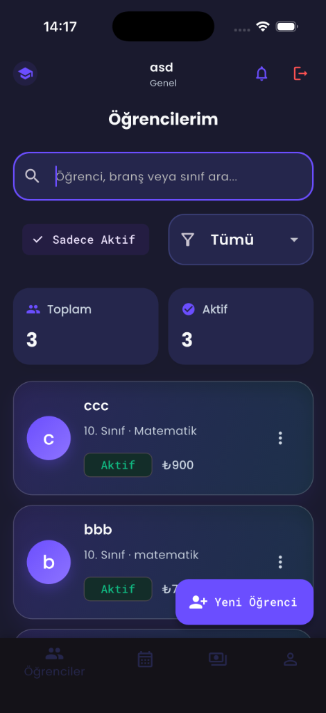
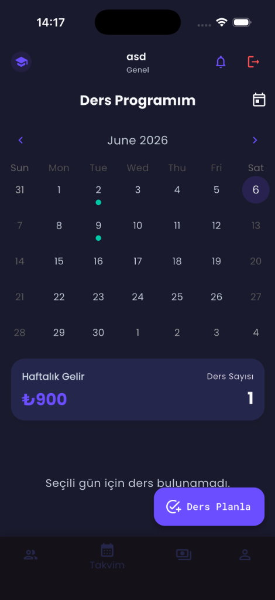
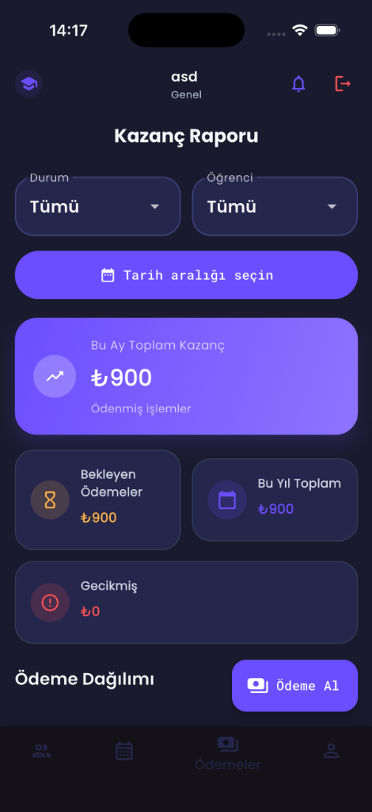
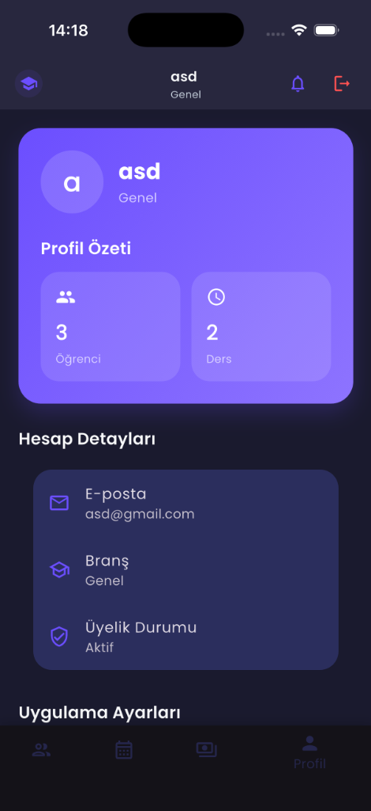

# 📚 DersHub

> Özel ders öğretmenleri için akıllı, modern ve hepsi bir arada yönetim uygulaması

DersHub, özel ders veren öğretmenlerin günlük iş yükünü hafifletmek için tasarlanmış **Feature-First (Özellik Odaklı)** mimarili bir mobil uygulamadır. Öğrenci takibi, sınav/sınıf düzeyleri, ders takvimi, otomatik ödeme yönetimi, interaktif notlar ve PDF gelişim raporlarını tek çatı altında toplar.

---

## 🎯 Ne İşe Yarar?

Özel ders öğretmenleri genellikle öğrenci bilgilerini, ders programlarını ve ödeme takiplerini farklı araçlarla (Excel, takvim uygulaması, not defteri vb.) yönetir. **DersHub**, bu dağınık süreci merkezi bir platforma taşıyarak öğretmenlerin zamandan tasarruf etmesini ve işlerini daha profesyonel yönetmesini sağlar.

### Uygulamayla neler yapabilirsiniz?

- 👨‍🎓 **Öğrencilerinizi Kaydedin ve Yönetin** — İsim, 1–12. sınıf düzeyleri, **Mezun** durumu veya **istediğiniz sınav adı** (*YKS Sayısal, KPSS, LGS, ALES vb.*) ile serbest metin girişi yaparak öğrencilerinizi kaydedin. Bilgilerini istediğiniz an canlı olarak düzenleyin.
- 🔍 **Akıllı ve Dinamik Filtreleme** — Öğrencilerinizi aktiflik durumuna, sınıf düzeyine veya kayıtlı özel sınavlarına göre anında listeleyip filtreleyin.
- 📅 **Ders Programınızı Planlayın** — Takvim üzerinde derslerinizi görsel olarak yönetin. Haftalık otomatik tekrarlayan dersler tanımlayın. Haftalık gelir ve ders sayınızı anlık takip edin.
- 💰 **Ödemelerinizi Takip Edin** — Ders oluşturduğunuzda otomatik olarak ödeme kaydı oluşturulur. Aylık kazanç raporu, bekleyen ödemeler, gecikmiş ödemeler ve ödeme dağılım grafikleriyle finansal durumunuzu her an görün.
- 📝 **Gelişmiş Renkli Notlar (CRUD)** — Öğrencilerinize özel veya genel notlar oluşturun. Notlarınızı **düzenleyin**, **onaylı olarak silin** ve renk paletleriyle kategorize edin.
- 📊 **Sınav ve Gelişim Takibi** — Sınav notlarını kaydedin, başarı grafiğini inceleyin; öğrenciler için profesyonel A4 gelişim raporu ve başarı sertifikası oluşturup PDF olarak paylaşın.
- 👥 **Grup Dersleri Planlayın** — Birden fazla öğrenciyi aynı grup dersine ekleyin, devam durumlarını ve bireysel ders notlarını takvim üzerinden takip edin.
- 💬 **Öğrencilerle İletişim Kurun** — SMS, cihaz WhatsApp uygulaması veya Twilio API üzerinden tek tıkla mesaj gönderin.
- 🔔 **Hatırlatmalar Alın** — Yaklaşan dersler ve ödeme tarihleri için otomatik yerel bildirimler alarak hiçbir şeyi kaçırmayın.
- 👤 **Profil & Güvenlik** — Ad ve branş bilgilerinizi düzenleyin; tema (açık/koyu), dil ve bildirim tercihlerinizi yönetin. Verilerinizi CSV olarak dışa aktarın.

---

## 📸 Ekran Görüntüleri

<p align="center">
  
  &nbsp;&nbsp;
  
  &nbsp;&nbsp;
  
  &nbsp;&nbsp;
  
</p>

<p align="center">
  <em>Soldan sağa: Öğrenciler · Takvim · Ödemeler · Profil</em>
</p>

---

## ✨ Modül Özellikleri

| Modül | Açıklama |
|---|---|
| 👨‍🎓 **Öğrenci Yönetimi** | Ekleme, düzenleme, silme; 1–12. Sınıf, **Mezun** ve **Özel Sınav (YKS, KPSS, LGS vb.)** desteği; dinamik filtreleme |
| 📅 **Ders Takvimi** | Bireysel ve grup dersleri, haftalık otomatik tekrar seçeneği ve takvim görünümü |
| 💰 **Ödeme Takibi** | Otomatik ödeme kaydı, tahsilat durumu, aylık gelir ve durum analiz grafikleri |
| 📝 **Not Defteri** | Öğrenciye bağlı veya genel notlar; tam düzenleme, onaylı silme ve renk kartları |
| 📊 **Sınav & Raporlar** | Sınav not girişi, FL Chart başarı eğrileri, PDF gelişim raporları ve başarı sertifikası |
| 👥 **Grup Dersleri** | Çoklu öğrenci katılımlı etüt/ders planlama, yoklama ve bireysel not takibi |
| 💬 **Mesajlaşma** | Cihaz SMS, Cihaz WhatsApp (wa.me) ve Twilio REST API entegrasyonu |
| 🔔 **Bildirimler** | Yerel bildirim sistemi (Local Notifications) ile ders ve ödeme alarmları |
| 🌙 **Tema & Yerelleştirme**| Material 3 açık/koyu dinamik tema ve Türkçe/İngilizce dil desteği |
| 🔐 **Firebase Auth** | E-posta/şifre ile güvenli kimlik doğrulama veya offline Mock Veri Modu |

---

## 🛠️ Teknoloji Yığını & Mimari

Uygulama, **Feature-First (Özellik Tabanlı)** katmanlı mimari prensiplerine göre yapılandırılmıştır:

### Mimari Katmanlar
- **Core Katmanı (`lib/core/`):** Tasarım sistemi (`theme.dart`), sabitler (`constants.dart`), yardımcı metotlar (`helpers.dart`) ve merkezi barrel export (`core.dart`).
- **Models Katmanı (`lib/models/`):** Freezed & JSON Serializable ile üretilmiş immutable veri modelleri (`models.dart`).
- **Services Katmanı (`lib/services/`):** Firestore, Authentication, Notifications, Messaging, PDF Generator ve Riverpod provider'ları (`services.dart`).
- **Features Katmanı (`lib/features/`):** Her özelliğin kendi UI ve Controller/State mantığını barındırdığı modüller (`features.dart`).

```
                    ┌───────────────────────────────┐
                    │      Features Layer (UI)      │
                    │ (Students, Calendar, Payments)│
                    └───────────────┬───────────────┘
                                    │ consumes
                    ┌───────────────▼───────────────┐
                    │      Riverpod Providers       │
                    │   (Reactive State & Streams)  │
                    └───────────────┬───────────────┘
                                    │ calls
                    ┌───────────────▼───────────────┐
                    │        Services Layer         │
                    │ (DatabaseService, AuthService)│
                    └───────────────┬───────────────┘
                                    │ parses
                    ┌───────────────▼───────────────┐
                    │     Models (Freezed / JSON)   │
                    └───────────────────────────────┘
```

### Kullanılan Kütüphaneler

- **Framework:** Flutter `3.27+` / Dart `3.6+`
- **Minimum iOS Target:** iOS `15.0` (Xcode 16+ uyumlu)
- **State Management:** [flutter_riverpod](https://pub.dev/packages/flutter_riverpod) `^2.6.1`
- **Backend & Veritabanı:**
  - [firebase_core](https://pub.dev/packages/firebase_core) `^3.13.1`
  - [firebase_auth](https://pub.dev/packages/firebase_auth) `^5.5.4`
  - [cloud_firestore](https://pub.dev/packages/cloud_firestore) `^5.6.9`
- **Grafik & Arayüz:**
  - [google_fonts](https://pub.dev/packages/google_fonts) `^6.2.1`
  - [fl_chart](https://pub.dev/packages/fl_chart) `^0.70.2`
  - [table_calendar](https://pub.dev/packages/table_calendar) `^3.1.3`
  - [flutter_spinkit](https://pub.dev/packages/flutter_spinkit) `^5.2.1`
- **PDF & Yazdırma:**
  - [pdf](https://pub.dev/packages/pdf) `^3.11.1`
  - [printing](https://pub.dev/packages/printing) `^5.13.4`
- **Bildirimler:**
  - [flutter_local_notifications](https://pub.dev/packages/flutter_local_notifications) `^18.0.1`
  - [timezone](https://pub.dev/packages/timezone) `^0.9.4`
- **Kod Üretimi:**
  - [freezed](https://pub.dev/packages/freezed) `^2.5.8`
  - [json_serializable](https://pub.dev/packages/json_serializable) `^6.9.4`
  - [build_runner](https://pub.dev/packages/build_runner) `^2.4.14`

---

## 📁 Dizin Yapısı

```
lib/
├── main.dart                       # Uygulama giriş noktası ve ProviderScope
├── firebase_options.dart.example   # Açık kaynak / klonlama için Firebase şablonu
│
├── core/                           # Çekirdek araçlar ve tasarım sistemi
│   ├── core.dart                   # Merkezi Core barrel export
│   ├── constants.dart              # Renkler, tipografi, sabit metinler
│   ├── helpers.dart                # Para/tarih formatlama, doğrulayıcılar
│   └── theme.dart                  # Material 3 Açık/Koyu tema tanımları
│
├── models/                         # Veri modelleri ve JSON serileştirme
│   ├── models.dart                 # Merkezi Models barrel export
│   ├── student.dart                # Öğrenci modeli (Freezed)
│   ├── lesson.dart                 # Bireysel ders modeli (Freezed)
│   ├── group_lesson.dart           # Grup dersi modeli (Freezed)
│   ├── payment.dart                # Ödeme modeli (Freezed)
│   ├── note.dart                   # Not modeli (CRUD destekli)
│   ├── exam.dart                   # Sınav modeli (Freezed)
│   ├── report.dart                 # Gelişim raporu modeli (Freezed)
│   ├── parent.dart                 # Veli modeli (Freezed)
│   ├── app_user.dart               # Kullanıcı oturum modeli
│   ├── teacher.dart                # Öğretmen profili
│   └── user_role.dart              # Kullanıcı rolleri (Öğretmen / Veli)
│
├── services/                       # Veritabanı, kimlik ve dış servisler
│   ├── services.dart               # Merkezi Services barrel export
│   ├── database_service.dart       # Firestore CRUD & Mock veri sağlayıcısı
│   ├── auth_service.dart           # Firebase Authentication
│   ├── firestore_service.dart      # Firestore genel sorgu yardımcısı
│   ├── student_service.dart        # Öğrenci iş akışları
│   ├── lesson_service.dart         # Ders oluşturma ve durum güncelleme
│   ├── group_lesson_service.dart   # Grup dersi yönetimi
│   ├── payment_service.dart        # Finansal işlemler ve tahsilat
│   ├── exam_service.dart           # Sınav notları servisi
│   ├── report_service.dart         # Raporlama iş mantığı
│   ├── pdf_generator_service.dart  # A4 PDF rapor ve sertifika üretimi
│   ├── messaging_service.dart      # SMS, WhatsApp & Twilio
│   ├── notification_service.dart   # Yerel ders ve ödeme alarmları
│   └── settings_service.dart       # Tema ve dil tercihleri
│
└── features/                       # Ekranlar ve kullanıcı arayüzü
    ├── features.dart               # Merkezi Features barrel export
    ├── auth/                       # Giriş, kayıt, şifre sıfırlama, splash
    ├── home/                       # Ana sayfa dashboard ve profil
    ├── students/                   # Öğrenci listesi, ekleme ve detay sayfası
    ├── calendar/                   # Ders takvimi, yeni ders & grup dersi
    ├── payments/                   # Gelir analizleri ve ödeme listesi
    ├── notes/                      # Renkli notlar kartları ve ekleme/düzenleme
    ├── reports/                    # Rapor listesi ve PDF önizleme
    └── parent/                     # Veli öğrenci takip görünümü
```

---

## 🚀 Kurulum ve Çalıştırma

### Ön Gereksinimler

- [Flutter SDK](https://docs.flutter.dev/get-started/install) `>=3.22.0`
- [Dart SDK](https://dart.dev/get-dart) `>=3.3.0`
- Xcode 16+ (iOS için) veya Android Studio (Android için)

### 1. Depoyu Klonlayın

```bash
git clone https://github.com/SalihaKaraman/DersHub.git
cd dershub
```

### 2. Bağımlılıkları İndirin

```bash
flutter pub get
```

### 3. Firebase Yapılandırması

Proje iki farklı şekilde çalıştırılabilir:

- **Seçenek A (Mock Veri Modu - Hızlı Başlangıç):**
  Firebase hesabı bağlamadan doğrudan test etmek için örnek şablonu kopyalayın:
  ```bash
  cp lib/firebase_options.dart.example lib/firebase_options.dart
  ```
  *Uygulama Firebase başlatılamadığında otomatik olarak bellek içi Mock Veritabanı moduna geçer ve tüm özellikleri sorunsuz deneyimlemenizi sağlar.*

- **Seçenek B (Gerçek Firebase Projesi):**
  ```bash
  dart pub global activate flutterfire_cli
  flutterfire configure
  ```

### 4. Kod Üretimini Çalıştırın (Freezed)

Modellerin `.freezed.dart` ve `.g.dart` kodlarını üretmek için:

```bash
dart run build_runner build --delete-conflicting-outputs
```

### 5. Uygulamayı Başlatın

```bash
# Mevcut cihazları listeleyin
flutter devices

# iOS Simülatöründe çalıştırın (Örn: iPhone 17)
flutter run -d "iPhone 17"

# Android Emülatör veya cihazda çalıştırın
flutter run
```

---

## 🧪 Test ve Kalite Kontrolü

DersHub projesinde statik analiz ve birim/widget testleri tam uyumlulukla geçer:

```bash
# Kod analizi (0 warnings, 0 errors)
flutter analyze

# Otomatik testleri çalıştırın
flutter test

# Belirli bir testi çalıştırın
flutter test test/report_test.dart
```

---

## 🔒 Güvenlik Notları

- **API Anahtarları:** `lib/firebase_options.dart` ve gizli ortam dosyaları `.gitignore` ile korunmaktadır. Açık kaynak repoya yüklenmez.
- **Dağıtım İmzaları:** Android için `key.properties`, `*.keystore` ve iOS için `*.p12` sertifikaları sürüm kontrolü dışındadır.
- **Firebase Kısıtlamaları:** Google Cloud Console üzerinden API anahtarlarınıza paket adı (`com.example.dershub`) ve Bundle ID kısıtlamaları eklenmesi tavsiye edilir.

---

## 🎨 Tasarım Sistemi

- **Primary:** `#6B4EFF` (İndigo / Mor)
- **Secondary:** `#00C9A7` (Zümrüt Yeşili)
- **Accent:** `#FFB547` (Amber Turuncu)
- **Success:** `#10B981` (Yeşil)
- **Error:** `#FF5252` (Kırmızı)
- **Karanlık Mod Yüzeyi:** `#1A1A2E`

---

## 📄 Lisans

Bu proje özel kullanım ve geliştirme amaçlıdır. Tüm hakları saklıdır.

<p align="center">
  Geliştirici: <strong>Saliha Karaman</strong> &nbsp;•&nbsp; Flutter ile ❤️ yapıldı
</p>
